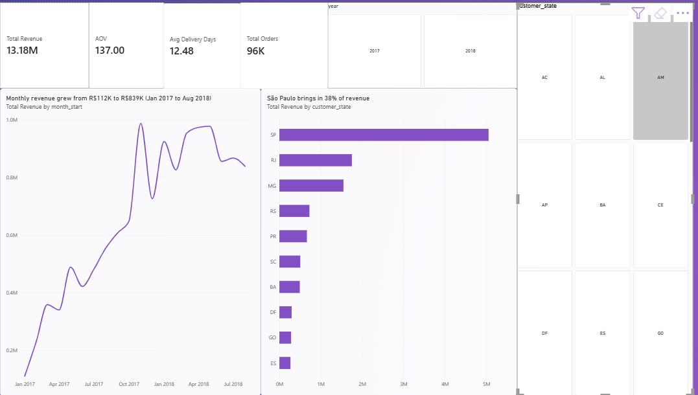
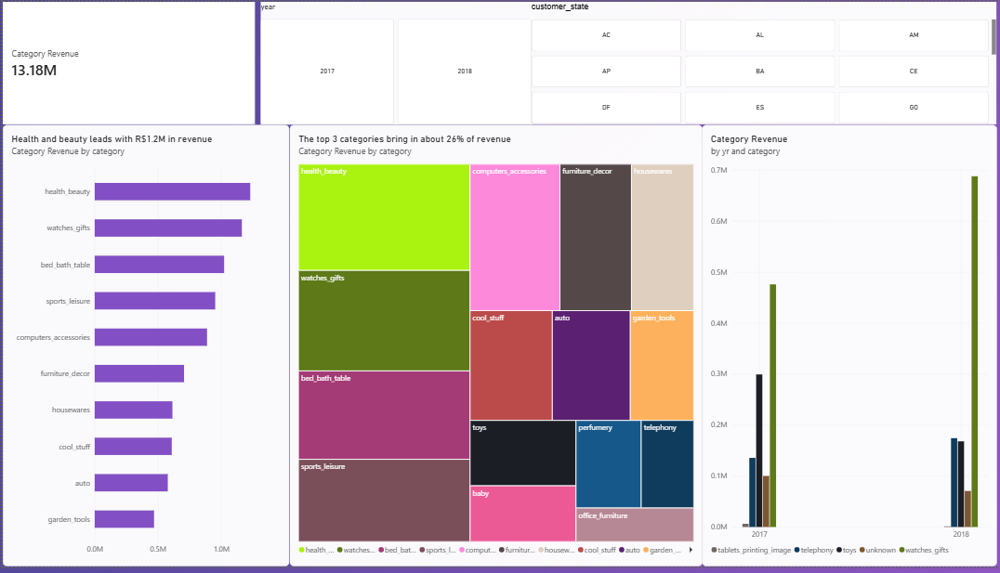
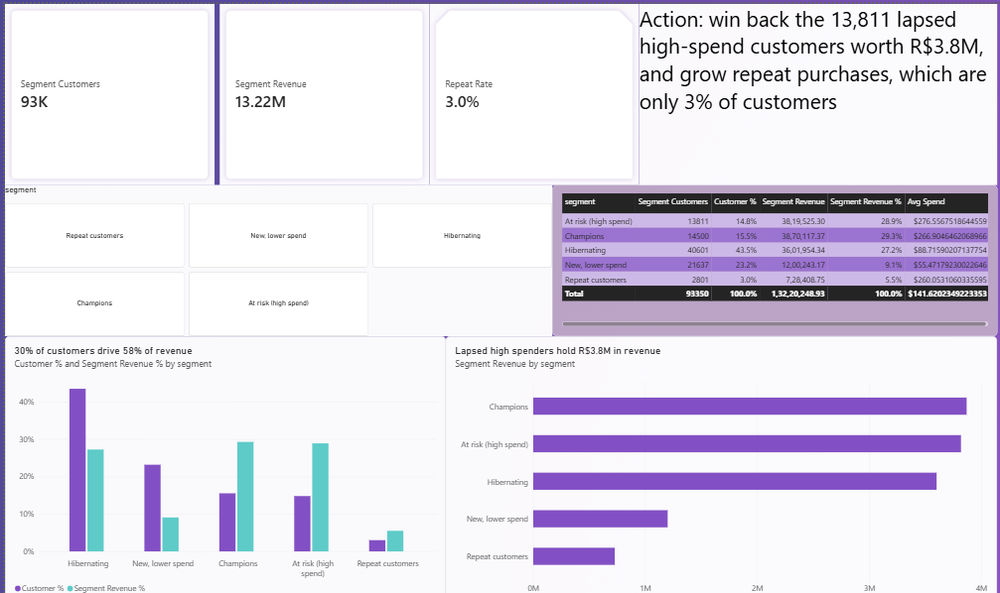
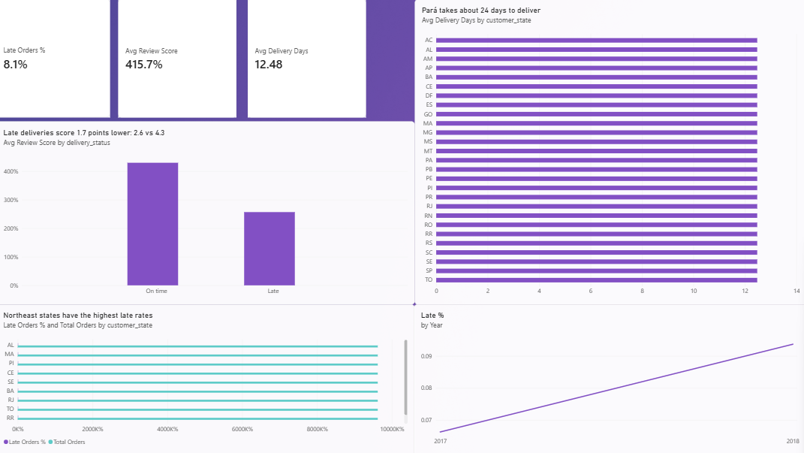

# E-Commerce Sales Analysis (Olist) | MySQL + Power BI

End-to-end data analytics project on a Brazilian e-commerce marketplace. I cleaned and analyzed 99K orders in **MySQL**, segmented customers with **RFM analysis**, and built a 4-page interactive **Power BI** dashboard with business recommendations.

## Business questions
1. How has revenue grown, and when are the peaks?
2. Which product categories and states drive the most revenue?
3. How good is delivery performance, and does it affect customer reviews?
4. Who are the most valuable customers, and which valuable customers are at risk of leaving?

## Dataset
[Brazilian E-Commerce Public Dataset by Olist (Kaggle)](https://www.kaggle.com/datasets/olistbr/brazilian-ecommerce): 9 related tables, 99,441 orders from 2016 to 2018. Raw CSV files are not included in this repo; download them from Kaggle.

## Tools
- **MySQL 8.0 / MySQL Workbench:** data loading, cleaning, joins, CTEs, window functions (`LAG`, `RANK`, `NTILE`), views
- **Power BI Desktop:** data model, DAX measures, interactive dashboard
- **Git / GitHub:** version control

## Approach
| Step | What I did | File |
|---|---|---|
| 1 | Created tables and loaded 7 CSV files | `sql/01_create_tables_and_load.sql` |
| 2 | Data quality checks and a clean base view (delivered orders only) | `sql/02_clean_and_views.sql` |
| 3 | Answered 9 business questions with SQL | `sql/03_business_analysis.sql` |
| 4 | RFM customer segmentation | `sql/04_rfm_segmentation.sql` |
| 5 | Built views for the dashboard | `sql/05_dashboard_views.sql` |
| 6 | Added a delivery and review view | `sql/06_delivery_review_view.sql` |
| 7 | Built the 4-page Power BI dashboard | `dashboard/Olist_Sales_Dashboard.pbix` |

**Key definitions:** revenue is item price (freight excluded) on delivered orders only. Customers are identified by `customer_unique_id`, because `customer_id` changes with every order. Currency is Brazilian reais (R$).

## Key findings
- **Scale:** 96,470 delivered orders from 93,350 customers across 27 states, generating **R$13.22M** in revenue, with an average order value of R$137.
- **Growth:** monthly revenue grew from R$112K (Jan 2017) to R$839K (Aug 2018). November 2017 jumped **52%** month over month (Black Friday).
- **Categories:** health_beauty leads with R$1.23M (9.3% of revenue), followed by watches_gifts and bed_bath_table. In 2018, health_beauty moved from third to first.
- **Geography:** São Paulo brings in **38%** of revenue. São Paulo, Rio de Janeiro, and Minas Gerais together bring in 63%.
- **Delivery:** the average delivery takes 12.5 days, and **8.1%** of orders arrive late. Northern and northeastern states are slowest, such as Pará at 23.7 days and Maranhão at 21.5 days with 19.7% of orders late.
- **Reviews:** late orders average **2.6 / 5** in reviews, against **4.3 / 5** for on-time orders, a gap of 1.7 points.
- **Retention:** only **3.0%** of customers buy again.
- **Payments:** credit cards make up 78.5% of payment value, and boleto 18%.

### RFM segments
| Segment | Customers | % of customers | Revenue | % of revenue |
|---|---|---|---|---|
| Champions | 14,500 | 15.5% | R$3.87M | 29.3% |
| At risk (high spend) | 13,811 | 14.8% | R$3.82M | 28.9% |
| Hibernating | 40,601 | 43.5% | R$3.60M | 27.2% |
| New, lower spend | 21,637 | 23.2% | R$1.20M | 9.1% |
| Repeat customers | 2,801 | 3.0% | R$0.73M | 5.5% |

The top two segments are 30% of customers but generate **58%** of revenue.

## Recommendations
1. **Win back lapsed high spenders.** About 13,800 high-spend customers hold R$3.8M in revenue (29% of the total) and haven't bought recently. Target them with a re-engagement offer.
2. **Fix delivery in the north and northeast.** Late orders cost 1.7 review points. Improving logistics or setting realistic delivery estimates in these states would protect reviews.
3. **Build a repeat-purchase program.** With only 3% repeat customers, a loyalty or follow-up offer after the first purchase has a lot of room to grow.
4. **Plan inventory for peaks.** Prepare capacity ahead of November, when sales jump by about half.

## Dashboard
A 4-page Power BI report built on SQL views, with year and state slicers on the pages that use them.

### Page 1: Overview
- **Cards:** R$13.18M revenue, 96,203 orders, R$137 average order value, 12.5 average delivery days (Jan 2017 to Aug 2018)
- **Visuals:** monthly revenue trend, top 10 states by revenue
- **Takeaway:** revenue grew from R$112K to R$839K a month, and São Paulo brings in 38% of it.

### Page 2: Products
- **Visuals:** top 10 categories, category treemap, top categories by year
- **Takeaway:** health_beauty leads with R$1.23M (9.3%), followed by watches_gifts (R$1.17M) and bed_bath_table (R$1.02M). In 2018, health_beauty reached R$756K and moved into first place.

### Page 3: Customers (RFM)
- **Cards:** 93,350 customers, R$13.22M revenue, 3.0% repeat rate
- **Visuals:** customer share versus revenue share by segment, revenue by segment, segment table with average spend
- **Takeaway:** Champions and lapsed high spenders are 30% of customers but 58% of revenue. About 13,800 "At risk (high spend)" customers hold R$3.8M.

| Segment | Customers | Revenue | Avg spend |
|---|---|---|---|
| Champions | 14,500 | R$3.87M | R$267 |
| At risk (high spend) | 13,811 | R$3.82M | R$277 |
| Hibernating | 40,601 | R$3.60M | R$89 |
| New, lower spend | 21,637 | R$1.20M | R$55 |
| Repeat customers | 2,801 | R$0.73M | R$260 |

### Page 4: Delivery and Reviews
- **Cards:** late-order rate (8.1%), average delivery days (12.5), average review score
- **Visuals:** review score for late versus on-time orders, late rate by state, delivery days by state, late rate by month
- **Takeaway:** late orders score 2.6 against 4.3 for on-time orders. Pará (23.7 days) and Maranhão (21.5 days, 19.7% late) are the slowest.

| Delivery | Orders | Avg review score |
|---|---|---|
| On time | 88,163 | 4.29 |
| Late | 7,661 | 2.57 |

Screenshots are in the `dashboard/screenshots/` folder:

## How to reproduce
1. Download the dataset from Kaggle and copy the CSV files into your MySQL `secure_file_priv` folder (check it with `SHOW VARIABLES LIKE 'secure_file_priv';`).
2. Run the scripts in `sql/` in order, from 01 to 06, in MySQL Workbench.
3. Open `dashboard/Olist_Sales_Dashboard.pbix` in Power BI Desktop and refresh it against your local `olist` database.

## Skills demonstrated
SQL (joins, CTEs, window functions, views), data cleaning, KPI design, RFM segmentation, DAX, dashboard design, and turning data into business recommendations.

## Author
**Kousik Rachapudi** | [LinkedIn](https://www.linkedin.com/in/rachapudi-kousik-0a52bb24a/) | [GitHub](https://github.com/kousikrachapudi/)